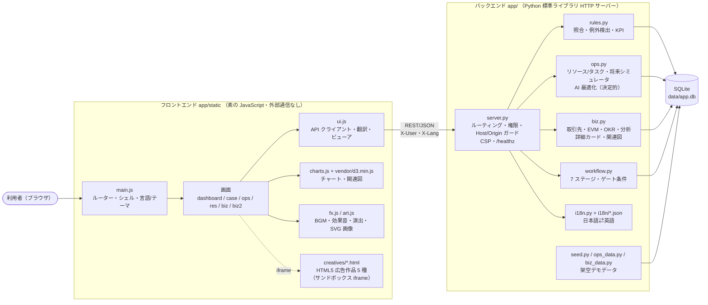
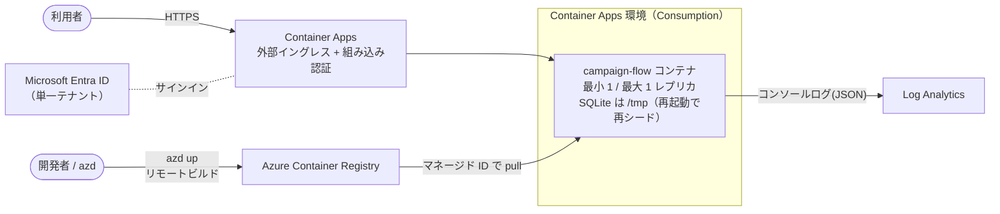

# Campaign Flow — 広告作品ライフサイクル管理（ローカル専用デモ）

[requirement-definition.md](docs/requirement-definition.md) のパイロット範囲を、**この PC の中だけで動く**形で実装したものです。既定では外部サービス・クラウド・外部通信・CDN は一切使いません（d3.js も `app/static/vendor/` に同梱）。Azure へのデモ用デプロイ準備（オプトイン）は [Azure へのデプロイ](#azure-へのデプロイ) を参照してください。

## 起動

Python 3.10 以上（標準ライブラリのみ。`pip install` 不要）。

```powershell
python -m app            # http://127.0.0.1:8765/
python -m app --port 9000 --db .\data\my.db
python -m unittest discover -s tests -t .
```

初回起動時に**架空のデモデータ**を `data/app.db`（SQLite）へ投入します。デモデータの版（`seed_version`）が変わった場合は、起動時に旧デモデータを置き換えます（監査ログを含む）。手動でリセットする場合は `data/` を削除して再起動します。

## できること

### 1. 広告作品のライフサイクル・ワークフロー（Dynamics 風の業務プロセスフロー）

案件画面の上部に **7 ステージのシェブロン** を表示します。ステージを選ぶと、そのステージの進行条件・タスク・作業領域が表示されます。

| ステージ | 主担当 | 作業領域（同じデータを入力・編集） |
|---|---|---|
| 1 企画・提案 | 営業 | 目的・ターゲット・予算・KPI のブリーフ |
| 2 見積・契約 | 営業 | 契約明細、予算との比較 |
| 3 制作 | 制作 | 広告作品（Web／動画／画像／ソーシャル／インタラクティブ）の登録 |
| 4 審査・承認 | 法務 | 作品の承認、権利期限と案件終了日の確認 |
| 5 展開・配信 | 媒体・運用 | 配信計画（ガント）、配信開始・完了、発注・納品 |
| 6 検収・請求 | 経理 | 検収・請求の取込、照合、請求関連の例外 |
| 7 効果測定 | 分析 | KPI 達成度、日次の成果、成果の記録 |

- **進行条件（ゲート）**：次のステージへは、データ条件（例：全作品が承認済み、承認済み作品が紐づいた配信がある）と全タスク完了を満たしたときだけ進めます。進められるのはそのステージの担当部署と業務責任者です。
- **部署の視点（レンズ）**：全体／営業／制作／媒体・運用／経理／法務／分析。同じ案件データを、部署ごとの切り口（指標・チャート・タスク）で見ます。自分の部署のレンズには「自分」バッジが付き、既定で選ばれます。
- **権限**：タスクは担当部署のみ更新可。ブリーフ・明細は契約確定まで直接編集でき、以降は変更管理を使います。差戻しは業務責任者のみ（理由必須）。

### 2. Microsoft Design（Fluent 2）の原則を適用した没入型 UI

| 原則 | 実装 |
|---|---|
| Natural on every platform | レスポンシブ（サイドレール→上部ナビ）、キーボード操作（←→／Esc／Enter）、ライト／ダーク、`prefers-reduced-motion` 対応 |
| Built for focus | 1 画面 1 目的のカード、ステージごとの作業領域、余白と階層による整理 |
| One for all, all for one | 部署レンズで同じデータを共有、色だけに頼らない状態表示（アイコン・文言）、フォーカスリング、`aria` ラベル |
| Unmistakably Microsoft | Segoe UI Variable、Mica 風の背景グラデーション、アクリル表面、リビール・ハイライト、シェブロンのプロセスバー |

没入感のための仕掛け：全画面の**作品ビューア**（PC／タブレット／スマホ切替、←→で前後）、ヒーロー領域、段階的に現れるモーション、カーソル追従のリビール。

### 3. HTML5 のサンプル広告作品（5 種・架空ブランド）

`app/static/creatives/` に、外部通信のない自己完結 HTML として収録しています。

| 作品 | 種別 | 内容 |
|---|---|---|
| `lp-aqualux` | Web サイト | スクロール連動 LP、フレーバー切替、液体アニメ、カウントダウン、応募フォーム |
| `video-aqualux15` | 動画 | Canvas で描く 15 秒の映像。再生・シーク・サウンド切替（合成音） |
| `banner-set` | 画像バナー | 300×250／728×90／160×600 のアニメーションバナー |
| `story-autumn` | ソーシャル | 9:16 のストーリー。タップ送り・長押し停止・カウントアップ |
| `car-configurator` | インタラクティブ | ボディ色・バッテリー・速度・昼夜を操作できる SVG コンフィギュレーター |

作品は `sandbox="allow-scripts"` の iframe で実行し、専用の CSP（`default-src 'none'` ＋ sandbox）で配信します。サムネイルは数秒で静止します（負荷対策）。ビューアでは常時動作します。

### 4. d3.js によるデータの表現

- ダッシュボード：ライフサイクル・パイプライン、日次推移（面＋7日平均＋十字カーソル）、例外ドーナツ、案件別の契約・原価・請求（グループ棒）、配信カレンダー（ガント）、アニメーションするヒーロー波形。
- 案件画面：データのつながり（フォースグラフ。ドラッグ・ズーム・ホバーで関連強調）、KPI ゲージ、予算消化バー、権利期限タイムライン、成果の日次推移。

### 5. 日本語／English の切替

画面上部の「日本語 | English」トグルで、UI・データ・広告作品の表示言語をその場で切り替えます（選択は `localStorage` に保存。既定は日本語）。

- **UI**：ナビゲーション、ボタン、フォーム、チャート、ツールチップ、通知、エラーメッセージまで翻訳されます。
- **データ**：デモの案件・明細・作品名・タスク・進行条件・例外の説明文・監査ログの詳細なども英語で表示されます（利用者が入力した文章は翻訳せず、そのまま表示します）。
- **広告作品**：5 種のサンプル作品も `?lang=en` で英語表示に切り替わります。
- **仕組み**：日本語の文字列をキーにした辞書（`app/i18n/*.json`、`{1}` などの位置プレースホルダ付きテンプレート対応）を、サーバー（`X-Lang: en` ヘッダーのとき API 応答を変換）とブラウザ（`/api/i18n` で同じ辞書を取得）が共通で使います。辞書にない文字列は推測せず原文のまま表示されるため、テスト（`test_english_api_has_no_untranslated_text`）で英語 API 応答に日本語が残らないことを検証しています。
- **文言の追加**：新しい日本語文言を足したら `app/i18n/` の辞書に英訳を追加してください。

### 6. リソース管理（`#/resources`）

人材・外部パートナー・スタジオ・機材の架空データを、**テーブル／ガント／サンキー／ヒートマップ**で切り替えて確認します。画面上部の「仮想の将来時刻」スライダーで、稼働率を未来の日付で見られます（過負荷は赤）。単価は業務責任者・経理・監査のみ表示されます。

### 7. タスク管理（`#/tasks`）

- 個人ではなく**チーム単位**の連携ボードとタイムライン（依存関係・遅延見込み付き）。
- チームの例外／会社としての例外を「判断が必要なタスク」として表示。各判断に複数の選択肢と、**AI分析による推奨案・信頼度・論理的な理由**（将来の日次シミュレーション結果から生成）。
- 選択中のユーザーにとって最重要の例外は**赤の大型アラート**、なければ**緑**で表示（ホーム・両管理画面・上部バーのピル）。判断できるのは該当チームと業務責任者のみ（会社の例外は業務責任者）。

### 8. AI Agent による最適化とシミュレーション

`タスク管理`と`リソース管理`の「AI Agentによる最適化」で、リソース再配分とタスク判断を Autopilot として提案します（ローカルの決定的なシミュレータと探索で動作し、外部の生成AIは使いません）。仮想の将来時刻（T+0〜T+28日）を再生／スクラブして、例外の累積・未完了タスク・過負荷の変化を「何もしない」場合と比較でき、**「許諾」するまで現在の計画は変わりません**。個別の判断も「選択した案の未来を見る」で同様に確認できます。`POST /api/ops/reset`（業務責任者）でデモを初期状態に戻せます。

### 9. 人物・顧客・商材のビジュアルとアイコン

人物のバストアップ（老若男女）、顧客・商材のアニメ調キャラクター、ガラス調アイコンはすべてコードで生成する SVG です（`app/static/art.js`）。

### 10. エンタメ演出

オープニング、ジェネレーティブ BGM と効果音（Web Audio で合成・ファイル不要）、パーティクル／衝撃波／画面シェイク／レッドアラート演出、AI の思考ログなど。上部バーの ♪／スピーカーで BGM・効果音を個別に切り替えられます（`prefers-reduced-motion` では抑制）。URL に `?nointro` でオープニングを省略できます。

### 12. 分析ダッシュボード（`#/analytics`）

- **KPI / OKR**：要求定義書 第6節の8指標に、運用拡張の指標（稼働率の適正度・将来の過負荷・判断の滞留・SPI平均・加重パイプライン）を加えた計13のKRを5つのObjectiveで監視。目標・基準・達成率・Day 100予測・判定（達成／順調／要注意／未達の恐れ）をリング・レーダー・バレット・スパークラインで表示します。実データから算出するものと模擬系列（手作業時間・利用定着）を明示しています。目標値は提案値で実績ではありません。
- **タスク分析**：累積フロー図、チーム別の作業状況、期限リスク・マップ、例外の種類。**リソース分析**：需要と供給、稼働率の分布、スキル別の需給、余力ランキング、コスト（権限者のみ）。

### 13. プロジェクト管理（`#/projects`、`#/project/<案件ID>`）

案件をプロジェクトとして管理：EVM（PV/EV/AC・SPI/CPI・EAC）と完成予測、マイルストーン、WBS（チーム別スケジュール・依存・遅延見込み）、リスクマトリクス／RAID、資源計画。ポートフォリオ・マップ（SPI×CPI）で健全性を一覧できます。

### 14. 取引先（`#/customers`、`#/customer/<ID>`）

8社の架空の取引先（財務5期分、過去の取引、商談、担当者、与信）。財務・広告意欲・関係・商談・与信から**営業ポテンシャル**と獲得可能額（推定）を算出し、次の一手を根拠付きで提案します。財務・与信・商談は営業・経理・業務責任者・監査・分析のみ閲覧できます。

### 15. ビジネス関連図（`#/relations`）と詳細カード

顧客 → 案件・商談 → 商材・チーム → 人・外部の取引先 → 作品・成果指標のつながりを、事業上の関係（受注・商談・商材提供・担当・要員配置・発注・制作物・成果指標）で表示。右クリックで関連する経路だけを強調します。全画面のデータ項目（案件・顧客・商材・リソース・チーム・タスク・判断・KPI・リスク・例外など）は、**マウスオーバーで詳細カード、クリックで関連画面へ遷移**します（`data-ent` 属性と `/api/biz/entity`）。

### 16. 以前からの機能

変更管理（自己承認不可・緊急変更の事後承認）、発注・納品・検収・請求の取込（外部参照 ID で冪等）、11 種の例外の自動検出と自動解決、差異承認（理由必須）、顧客別の閲覧制御、監査ログ。

## ローカル専用であることの担保

- 既定では `127.0.0.1` 以外へのバインドを起動時に拒否します（`--host` も同様）。Azure 向けのホスト型は、`APP_REMOTE_HOSTS`（許可する公開ホスト名）を明示した場合に限るオプトインです（[Azure へのデプロイ](#azure-へのデプロイ)）。
- `Host` が許可リスト（既定はローカルホスト）以外の要求、別 `Origin` からの POST は拒否します。POST は `application/json` のみ。
- 画面の CSP は `default-src 'self'`（外部リソースなし）。作品ページは別 CSP でネットワーク不可・サンドボックス。
- 生成 AI・外部 API は使用しません。変更影響の候補は文字列一致によるルールベースです。

## 使い方のヒント

アプリを開くと**ロール選択画面**が表示されます（オープニングの後）。ロールを選ぶと、その役割と顧客の閲覧範囲で画面が開き、上部バーの「ロール選択」からいつでも選択画面へ戻れます（Esc でキャンセル）。上部のプルダウンでも切り替えられます。`sales2` は A 社のみ、`audit1` は監査ログのみ閲覧できます。**これは認証ではありません**。

1 本のライフサイクルを通して試す例：「新規案件」→ 営業で企画タスクを完了 → 分析に切り替えて分析タスクを完了 → 営業で「次のステージへ」→ …（制作で作品登録 → 法務で承認 → 媒体で配信計画・発注 → 経理で検収・請求 → 分析で成果記録）。`tests/test_app.py` の `test_full_lifecycle_across_departments` が同じ流れを自動検証しています。

## アプリケーション構成

### コンポーネント図



### Azure 上の構成（ホスト型・デモ用）



詳細な評価（Azure Well-Architected Framework との突合、ブロッカー、改善計画）は [docs/WAF-Analytics.md](docs/WAF-Analytics.md) を参照してください。

### ファイル構成

```
app/
  server.py     標準ライブラリの HTTP サーバーと API
  workflow.py   ステージ・タスク雛形・ゲート条件
  rules.py      照合・例外検出・KPI・ポートフォリオ集計
  seed.py       架空デモデータ（決定的。実行日基準）
  ops.py / ops_data.py  リソース・チーム作業・判断データ、将来シミュレータ、AI最適化（/api/ops/*）
  biz.py / biz_data.py  取引先・プロジェクト(EVM)・KPI/OKR・分析・詳細カード・関連図（/api/biz/*）
  i18n.py       日本語→英語の翻訳（辞書＋テンプレート）。辞書は i18n/*.json
  db.py         SQLite スキーマと軽量マイグレーション
  static/       UI（ui.js / charts.js / dashboard.js / case.js / main.js ほか）、vendor/d3.min.js、creatives/
tests/test_app.py
Dockerfile / .dockerignore / azure.yaml   コンテナ化と azd 設定
infra/        Bicep（main.bicep・app.bicep・main.parameters.json）
docs/         調査書・要求定義書・WAF-Analytics.md（Azure 向けアセスメント）
```

## Azure へのデプロイ

**デモ用途（架空データ）に限定**した準備です。本番運用には [docs/WAF-Analytics.md](docs/WAF-Analytics.md) のブロッカーの解消が必要です。既定のローカル動作は変わりません。

前提：Azure CLI、Azure Developer CLI（azd）、対象サブスクリプションの所有者相当の権限（リソース グループ作成とロール割り当てのため）。Docker は不要（ACR でリモートビルド）。

```powershell
./infra/deploy.ps1 -SubscriptionId <サブスクリプションID> -TenantId <テナントID> -ContactEmail <予算アラートの送信先>
```

スクリプトは、Entra アプリ登録（単一テナント）→ `azd up`（Japan East を優先し、使えなければ Japan West / East Asia / Southeast Asia の順に試行）→ リダイレクト URI の登録 → `/healthz` と未認証アクセスの確認まで行い、再実行しても安全です。手動で行う場合の要点は次のとおりです。

```powershell
azd env new campaignflow --subscription <サブスクリプションID>
azd env set AZURE_LOCATION japaneast
azd env set AUTH_CLIENT_ID <アプリ登録のクライアントID>
azd env set AUTH_CLIENT_SECRET <クライアント シークレット>
azd env set BUDGET_CONTACT_EMAIL <メール>
azd up
az ad app update --id <クライアントID> --web-redirect-uris (azd env get-value SERVICE_WEB_REDIRECT_URI)
```

- **予算**：リソース グループに月額 100,000（サブスクリプションの請求通貨。円建てなら 10 万円）の予算を作成し、実績 50%・80%・100% と予測 100% でメール通知します。想定コストは小規模（Container Apps 0.5 vCPU×1、ACR Basic、Log Analytics）で、予算を大きく下回る見込みですが、実額は未見積りです。
- 初回の `azd provision` ではプレースホルダのイメージが起動するため、リビジョンは `azd deploy` が完了するまで正常になりません。
- 認証なしの公開はできません（`authClientId` は必須）。「ロール選択」は**認証ではありません**。サインインできる同一テナントの利用者は全員が全ロールを選べます。
- 未検証事項：Docker イメージのビルド、サインインの動作は、Azure 上では未確認です（ローカルでは Bicep のコンパイルとホスト型モードの単体テストのみ確認）。

## 限界

- 外部システム連携、成果指標の自動取込、通知、月次レポート、効果測定の対照群設計は含みません。成果データは手入力または架空データです。
- 数値目標・閾値（検収後 5 日、期限 3/7/14 日など）は仮置きです。コンバージョンは因果効果を示すものではありません。
- 金額は円の整数前提の浮動小数で保持しています（本番では通貨・税・丸めの定義が必要）。
- 単一プロセス・単一 DB 接続の排他制御のため、同時多数の利用は想定しません。
- d3.js 7.9.0（ISC ライセンス、`app/static/vendor/d3.LICENSE.txt`）を同梱しています。
